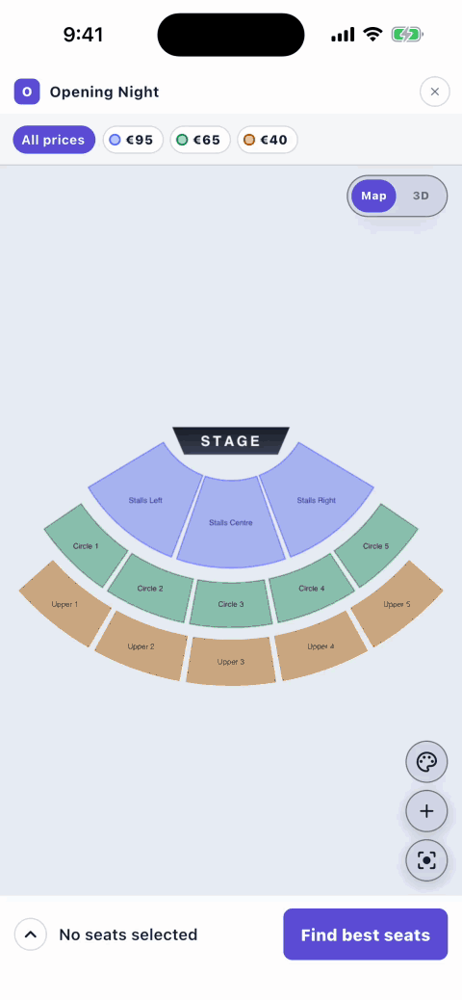
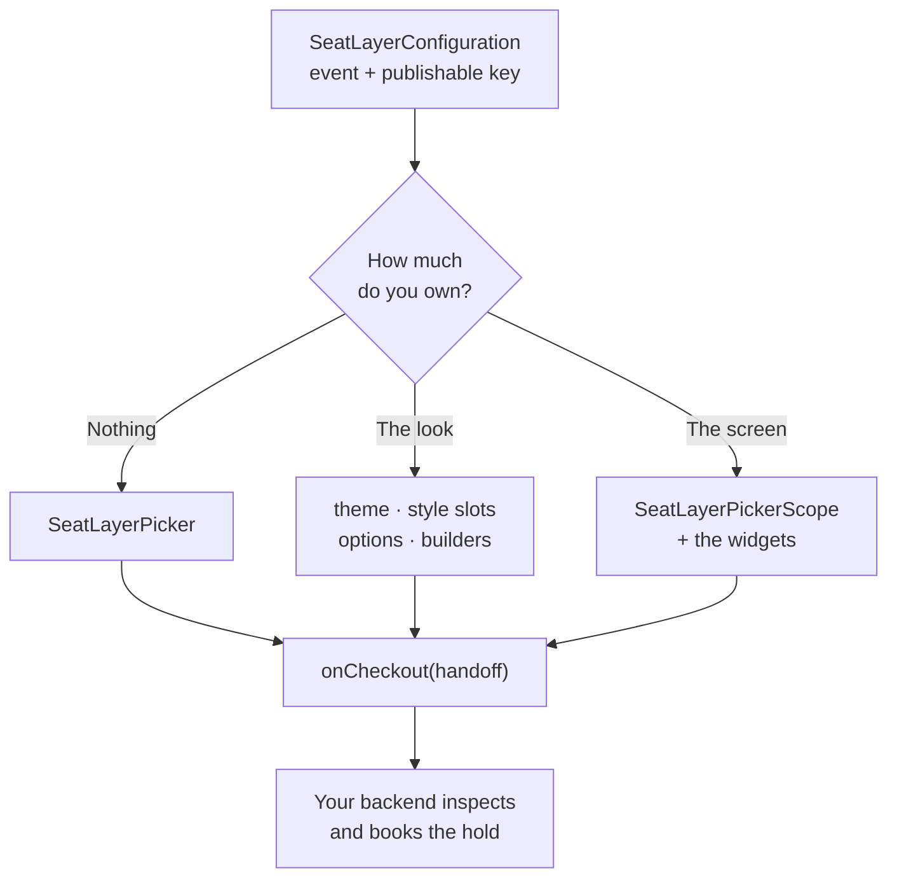

# SeatLayer SDK for Flutter: seat map and seat picker for iOS and Android

[](https://github.com/seatlayer/seatlayer-flutter/actions/workflows/ci.yml)
[](https://pub.dev/packages/seatlayer)
[](https://flutter.dev/)
[](https://dart.dev/)
[](LICENSE)

The official SeatLayer Flutter seat map SDK adds an interactive seating chart
and seat picker to Flutter ticketing apps on iOS and Android. Use Dart APIs and customizable
Flutter widgets for live availability, best-available seats, and temporary
holds, then confirm bookings on your trusted backend. SeatLayer is seating chart
and reserved-seat ticketing software built for venues up to stadium scale.



## What SeatLayer is

SeatLayer is reserved-seat ticketing and seating software: organizers sell with hosted checkout,
a box office, door check-in and season tickets, and platforms add the same seat maps, with 3D
seat views, through the SeatLayer SDK and API. One chart drives the 2D map, the 3D venue and the
view from each seat (3D for venues up to 60,000 seats; the 2D map benchmarked at 200,000 seats).

[Website](https://seatlayer.io/) · [For developers](https://seatlayer.io/developers/) ·
[Season tickets](https://seatlayer.io/season-tickets/) · [Pricing](https://seatlayer.io/pricing/) ·
[Live demo](https://seatlayer.io/demo/)

Season tickets are in the web and server SDKs today, not in this SDK.

## Try it

- [Buyer seat-map demo](https://app.seatlayer.io/demo/play/grand-theatre) in your browser, no account needed · [All live demos](https://seatlayer.io/demo/)
- [Quickstart](https://docs.seatlayer.io/start/quickstart/): your first event and keys
- [Flutter seat-map documentation](https://docs.seatlayer.io/buyer-sdk/flutter/) · [Customize the Flutter seat picker](https://docs.seatlayer.io/buyer-sdk/flutter/customise/) · [Holds and checkout](https://docs.seatlayer.io/buyer-sdk/holds-and-checkout/) · [SDK catalog](https://docs.seatlayer.io/sdk-catalog.json)
- [SeatLayer Flutter package on pub.dev](https://pub.dev/packages/seatlayer) · [SeatLayer SDK and API overview](https://seatlayer.io/developers/)
- [Pricing](https://seatlayer.io/pricing/): test mode is free; live, the first 100 sold seats each month are free, then 10¢ down to 5¢ per sold seat, with no subscription, and purchased credits never expire.

Two-step shape: the buyer picks and holds seats in the client with your public key, then your server confirms the booking with your secret key while your platform keeps checkout and its own payment provider.

More from SeatLayer:
[SeatLayer iOS seat map SDK](https://github.com/seatlayer/seatlayer-ios) ·
[SeatLayer Android seat map SDK](https://github.com/seatlayer/seatlayer-android) ·
[SeatLayer React Native SDK](https://github.com/seatlayer/seatlayer-react-native) ·
[SeatLayer AI Toolkit](https://github.com/seatlayer/seatlayer-ai-toolkit)

## Quick start

```bash
flutter pub add seatlayer
```

> **Latest release:** see the version on [pub.dev](https://pub.dev/packages/seatlayer).
> Pin it in `pubspec.yaml` and test your event, checkout hand-off and target
> devices before release.

```dart
import 'package:seatlayer/seatlayer.dart';

SeatLayerPicker(
  configuration: SeatLayerConfiguration(
    event: 'ev_your_event',
    publicKey: 'pk_test_your_key',
  ),
  themeMode: SeatLayerThemeMode.auto,
  onCheckout: (handoff) => bookOnYourBackend(handoff.holdId),
  onClose: () => Navigator.of(context).pop(),
)
```

That is the whole flow: live inventory, price and accessibility filters, section
and floor navigation, seat confirmation, GA and table prompts, Best Available,
the cart, a hold with its countdown, real venue 3D, the seat-view panorama and
the checkout handoff. It fills the bounded space its parent gives it, so do not
nest it in a gesture-driven `ListView` or `SingleChildScrollView`.

`SeatLayerPickerPage(configuration:, onCheckout:)` is the same widget as a route
you push; `showSeatLayerPicker(context, configuration:, presentation:)` is it as
a modal returning the handoff, or `null` if the buyer closes it. `adaptive` is
edge-to-edge on a phone and a constrained dialog at 700 logical pixels or wider;
`.fullScreen` / `.dialog` force one. Both intercept close and system back and
release a picker-owned hold before the route leaves. A hold already handed to
you is never released.

**Map version.** Each SDK release uses one matching SeatLayer map version,
exported as `seatLayerHostedWebVersion`, so an app on a given `seatlayer`
version always shows the same map.

Register the SDK's renderer origin, `https://cdn.seatlayer.io` (exported as
`seatLayerMobileOrigin`), on the publishable key you use. For private,
login-gated, presale, partner or channel inventory, drop `publicKey` and mint a
short-lived, origin-bound buyer session from your own backend instead:

```dart
SeatLayerConfiguration(
  event: 'ev_private',
  buyerAccessTokenProvider: (request) =>
      buyerBackend.mintSeatLayerAccess(request.reason),
)
```

Never ship a SeatLayer secret in the app binary.

**Prepare the picker in advance (optional).** Call `SeatLayerPicker.prewarm()`
when the event screen appears. It is safe to call on every build; an unused one
is released after a few minutes or on memory pressure, and
`SeatLayerPicker.cancelPrewarm()` releases it early.

```dart
@override
void initState() {
  super.initState();
  SeatLayerPicker.prewarm();
}
```

**Stay current when the buyer comes back.** A picker that has been in the
background learns nothing while it is there, so a buyer returning from a
payment sheet or a phone call can otherwise tap a seat somebody else already
bought. The picker re-reads live availability whenever it comes back to the
front, and reconciles the buyer's hold against the server rather than against
the in-app countdown, which may never have fired at all. Seats the buyer had
selected and lost reach `onSelectedObjectUnavailable`; a hold that lapsed is
stated once in the cart sheet, and `Select them again` re-selects the seats that
are still free and holds them, so the buyer is back where they were rather than
one step short of it. A seat sold in the moment between the two is reported like
any other failed hold, and the seats are left selected and unheld rather than
claimed.

Add `SeatLayerPicker.routeObserver` so the same thing happens when your own
checkout screen pops back; that path never backgrounds the application, so
nothing else can notice it:

```dart
MaterialApp(
  navigatorObservers: <NavigatorObserver>[SeatLayerPicker.routeObserver],
  home: const MyHome(),
)
```

It is optional: without it the lifecycle trigger still works and nothing
complains. `SeatLayerPickerOptions(refreshOnResume: false)` turns both triggers
off, and `announceHoldLapse: false` keeps the refresh but leaves the lapse
message to you; `onHoldExpired` fires either way. Call
`controller.refreshAvailability()` yourself from a composed layout. Details:
[lifecycle and recovery](https://docs.seatlayer.io/buyer-sdk/flutter/lifecycle-and-recovery/#control-automatic-behavior).

## Works as a native picker

**Every piece of chrome is a Flutter widget.** The header, price rail, floor strip, section dock, seat confirm card,
cart sheet, checkout button and the captions over the 3D scene and the seat-view
panorama are all Dart: drawn in your palette, laid out by Flutter, replaceable
one at a time. The seat map itself (seats, labels, sections, the 3D scene and
the view from a seat) is the SeatLayer map from the web, shown inside your app.
It leaves the tooltip, test badge and buttons to your Flutter widgets, so
nothing is drawn twice.

Three ways in, and they are a ladder: each level keeps what the one below gave
you. Level 2 is not an escape hatch and level 3 is not a rewrite: the drop-in is
built from exactly the widgets level 3 hands you.

| | You want | You write | You keep |
| --- | --- | --- | --- |
| **1** | The whole buyer flow, now | `SeatLayerPicker(…)` | Everything below |
| **2** | It, in your brand and your words | A theme, a style slot, an option, a builder | The layout, the flow, the holds |
| **3** | Your own screen | `SeatLayerPickerScope` + the widgets | Inventory, holds, snapshots, checkout |



## Customise the picker

Four levels, cheapest first. None of them rebuilds the layout or the flow.

**Colours and type: a theme.** One line adopts an app palette whole. Before,
the SeatLayer palette; after, yours, on the chrome and the drawn map together:

```dart
theme: SeatLayerPickerThemeData.fromColorScheme(Theme.of(context).colorScheme),
```

**One control's shape: a style slot.** Every surface the picker draws has a
slot on the theme, so one control changes without replacing the widget:

```dart
// before: the picker's 8-pt button radius everywhere.
// after: only the checkout action is a pill; every other button is untouched.
theme: SeatLayerPickerThemeData.light(
  styles: SeatLayerPickerStyles(
    continueButtonStyle: FilledButton.styleFrom(shape: const StadiumBorder()),
  ),
)
```

Slots: `primaryButtonStyle`, `secondaryButtonStyle`, `continueButtonStyle`,
`iconButtonStyle`, `chipShape`, `legendChipStyle`, `floorStripStyle`,
`seatViewChromeStyle`, `dockBarStyle`, `confirmCardStyle`, `sheetStyle`,
`headerStyle`, `pillStyle`. Button slots take a Material `ButtonStyle`; surface
slots take a `SeatLayerSurfaceStyle` (colour, shape, elevation, padding, type).
Every widget owning a slot also takes `style:`, which wins for that one instance,
for example `SeatLayerDockBar(style: SeatLayerSurfaceStyle(shape: …))`.

**Sizes, visibility and words: layout, chrome switches, strings.** The spec's
numbers are defaults, not constants, and every buyer-facing string is an
override:

```dart
// before: the approved phone metrics and English defaults.
// after: a taller dock, no floor strip, French wording.
theme: const SeatLayerPickerThemeData.light(
  layout: SeatLayerPickerLayout(dockBarHeight: 60, sheetMaxHeightFraction: .5),
),
options: SeatLayerPickerOptions(
  chrome: const SeatLayerPickerChromeOptions(showFloorStrip: false),
  strings: SeatLayerPickerStrings(holdAndCheckout: 'Réserver et payer'),
),
```

Or take the thirty-seven translations SeatLayer already ships, from the same
reviewed dictionaries the drawn map uses:
`strings: SeatLayerPickerStrings.forLocale(Localizations.localeOf(context))`.
It resolves by language, and by script for Chinese; an untranslated locale (and
any entry with no runtime wording, currently just `allFloors`) keeps its
English default, and the result is an ordinary `SeatLayerPickerStrings` you can
still override on top of.

**One whole part: a builder slot.** The builder receives the live state, the
controller and the widget the drop-in would have rendered:

```dart
// before: the picker's own cart sheet. after: yours, the rest untouched.
builders: SeatLayerPickerBuilders(
  cartSheet: (context, part) =>
      MyOwnSheet(state: part.state, fallback: part.defaultChild),
),
```

Slots: `map`, `header`, `legend`, `floorStrip`, `sectionNavigator`, `dockBar`,
`accessibilityFilters`, `mapControls`, `selectionTray`, `cartSheet`,
`checkoutBar`, `venue3D`, `seatViewChrome`.

The test badge has no builder slot: its colours and type follow your theme, but
it cannot be returned as an empty widget. Organizer ticket categories are never
rebranded, because they mean a price.

## Build your own layout

Place a `SeatLayerPickerScope` and arrange the widgets yourself. Each reads its
own state from the scope, so nothing needs the drop-in layout:

```dart
SeatLayerPickerScope(
  configuration: configuration,
  themeMode: SeatLayerThemeMode.auto,
  child: Column(children: [
    SeatLayerPickerHeader(compact: true, onClose: close),
    const Expanded(child: Stack(children: [
      Positioned.fill(child: SeatLayerChart()),
      Positioned(top: 8, left: 0, child: SeatLayerPriceLegend(compact: true)),
      Positioned(top: 40, left: 0, right: 0, child: SeatLayerFloorStrip()),
      Positioned.fill(child: SeatLayerPickerMapControls(compact: true)),
      Positioned(left: 0, right: 0, bottom: 0, child: SeatLayerDockBar()),
      Positioned.fill(child: SeatLayerVenue3D()),
      Positioned.fill(child: SeatLayerSeatViewChrome()),
    ])),
    SeatLayerCartSheet(expanded: expanded, onCheckout: book,
        onExpandedChanged: (v) => setState(() => expanded = v)),
  ]),
)
```

**Every action is a callback.** All optional; a picker with none is still a
complete buyer flow:

```dart
callbacks: SeatLayerPickerCallbacks(
  onReady: (info) => debugPrint('ready in ${info.timeToReadyMs} ms'),
  onSelectionChanged: (seats) => setState(() => _seats = seats),
  onSectionFocused: (id) => analytics.log('section', id),
  onHoldChanged: (hold, handoff) => _armCountdown(hold),
  onContinue: (handoff) => analytics.log('checkout', handoff.holdId),
  onError: (error) => report(error),
)
```

Also `onSeatSelected`, `onSeatRemoved`, `onSeatViewOpened`,
`onSelectionValidityChanged`, `onHoldExpired`, `onAccessExpired`,
`onAccessUnavailable`, `onSelectedObjectUnavailable`, `onThemeResolved`,
`onClosed`.

**Drive it directly.** The controller speaks typed Dart methods:

```dart
await picker.selectObjects(['A-12', 'A-13']);
await picker.setMaxSelection(4);
await picker.focusSection('section-a');
await picker.setFloor('mezzanine');     // or picker.showAllFloors()
await picker.showSeatIn3D(seat);        // enter or retarget without remounting
await picker.openSeatView(seat);        // authored 360° or drawn preview
await picker.setViewportInsets(insets); // frame clear of your own chrome
```

Dispose a controller you created, and `await picker.close()` first so a
picker-owned hold is acknowledged as released.

**Cover the map safely.** An `IgnorePointer` is not enough on iOS: UIKit can
hit-test the venue map beneath composited Flutter chrome, so bracket your own
overlay with `await picker.setMapInteractionEnabled(false)` and `true` in a
`finally`, which makes the map itself inert. The turnkey layout already does
this around its decision chrome. Do not wrap the map in an app-level drag or
scale recognizer and do not forward raw touch coordinates to it: both fight the
map's own tap-versus-pan suppression.

**One back gesture, one ladder.** Android predictive back and the iOS edge swipe
both reach the picker's `PopScope`, which walks seat card → section → overview →
dismiss rather than leaving on the buyer's first try out. **Haptics** fire one
cue on selection, removal, a section landing, a hold and a hold expiry, decided
off the snapshot so they never buzz twice for one seat;
`SeatLayerPickerOptions(haptics: false)` turns them off.

## Theme

`themeMode` resolves in one order: **your `themeMode` → your app's theme → the
device.** `auto` reads `Theme.of(context).brightness` first, so it tracks the
dark-mode switch inside your app (the setting the buyer actually chose) and
falls back to `MediaQuery.platformBrightness` only when no Material or Cupertino
theme sits above the picker. Either reading is live: flip your app's theme or
the device appearance and the chrome **and the drawn map** repaint together, no
reload, no lost selection, no moved camera.

```dart
themeMode: SeatLayerThemeMode.auto,
theme: const SeatLayerPickerThemeData(accent: Color(0xFFE54558)),
```

The default constructor sets only the roles you name, so every ground role still
comes from `themeMode`. Name `accent` alone and the ink on it is derived for
you: white, the colour a brand already puts on its own, unless the accent is
pale enough that white cannot be read on it (a yellow, a mint, a near-white
tint), where it turns black. Pass `onAccent` to say it yourself and the picker
uses exactly that, whatever it reads like. **A preset pins the mode:**
`SeatLayerPickerThemeData.light()` and `.dark()` are complete ground palettes;
each also sends a contrast-paired `SeatLayerMapThemeData` for the canvas
background, row labels, free text and the selection ring, and an explicit
ground outranks a resolved mode, so `themeMode: auto` with `.light()` never goes
dark. Reach for a preset when you want one fixed side; pick the preset yourself
if you want both.

The status and navigation bars are the picker's surface, so the picker dresses
them: light glyphs on a dark picker, dark on a light one, dark for the
immersive scene either way, re-evaluated on every `auto` flip.
`SeatLayerPickerChromeOptions(manageSystemOverlays: false)` opts out;
`seatLayerPickerOverlayStyle(resolvedTheme)` still says what it would have set.

## Checkout handoff

The app selects and holds inventory. Your trusted backend inspects and books the
hold after payment or order validation.

`SeatLayerCheckoutHandoff` carries an opaque `holdId`, the server expiry, the
currency, priced line items with object/category/tier identity and seat address,
and a display total. The ordinary picker snapshot deliberately does **not**
contain the `holdId`: it says only whether a hold is active, when it expires and
who owns it. The capability crosses into Dart at the handoff and nowhere else.

- Never ship a SeatLayer secret in the app.
- Never put buyer tokens or hold ids in logs, analytics or URLs.
- Send the `holdId` only to your trusted checkout backend.
- Inspect the hold server-side and calculate the charge from server data.
- Reuse a stable host order id as the booking reference for safe retries.

Checkout transfers ownership: closing the picker afterwards must not release the
hold, while closing *before* handoff releases a picker-owned one. Process
termination cannot guarantee a release, so the server TTL is the final boundary.
If a turnkey `onCheckout` throws, the picker rejects the handoff before
surfacing your error; it can release only the exact hold that session just
handed over. A custom flow rolls back the same way:

```dart
final handoff = await picker.checkout();
try {
  await openCheckout(handoff);
} catch (_) {
  await picker.rejectCheckoutHandoff(handoff);
  rethrow;
}
```

`SeatLayerPickerOptions(initialHoldId:)` always restores a **host-owned** hold;
ownership is not caller-configurable and picker cart controls never release it.
`readOnly: true` inspects a map, selection or restored hold with inventory
changes refused in the runtime *and* in the controller, which fails such a call
with a typed `read_only` error rather than relying on hidden UI. Continue with
[holds and secure server-side checkout](https://docs.seatlayer.io/buyer-sdk/holds-and-checkout/).

## Widget catalogue

Every widget below works standalone inside a `SeatLayerPickerScope`.

| Widget | What it draws |
| --- | --- |
| `SeatLayerChart` | The map itself (alias of `SeatLayerPickerMap`) |
| `SeatLayerPickerHeader` | Event identity, hold pill, dismiss |
| `SeatLayerPriceLegend` | Price chips that filter the map |
| `SeatLayerFloorStrip` | Floor chips on a multi-floor venue |
| `SeatLayerDockBar` | Focused section, seats left, prev/next, Venue |
| `SeatLayerPickerMapControls` | Accessibility, fit, Map/3D in the corners |
| `SeatLayerConfirmCard` | The phone's one-seat decision card |
| `SeatLayerCartSheet` | Peek bar and content-height cart |
| `SeatLayerCartList` | The dense ticket list with run folding |
| `SeatLayerBestSeatsForm` | Two selects, a stepper, one action |
| `SeatLayerBookButton` | The full-width checkout call to action |
| `SeatLayerVenue3D` | Caption, seat stepper and exits over the 3D scene |
| `SeatLayerSeatViewChrome` | Caption strip and badge over the panorama |
| `SeatLayerPickerAccessibilityFilters` | Access needs, colourblind palette |
| `SeatLayerPickerTablePrompt` / `…GeneralAdmissionPrompt` | Quantity prompts |
| `SeatLayerPickerSectionNavigator` | Section list and stepping |
| `SeatLayerPickerTestModeIndicator` | The one test-event badge |
| `SeatLayerPickerAttribution` | Draws the badge only when the server requires it; the server requires it on no plan, so it draws nothing |

The individual corner controls (`…ZoomInButton`, `…ZoomToFitButton`,
`…ViewModeControl`, `…ColorblindButton`, `…OverviewButton`,
`…3DNavigationModeButton`), the status views (`…LoadingView`, `…ErrorView`,
`…EmptyView`, `…ActionError`) and the seat inspection buttons
(`…SeatViewButton`, `…Seat3DButton`) are exported too, all prefixed
`SeatLayerPicker`. Each is absent rather than decorative when the venue map
does not support what it drives.

`SeatLayerView` remains for an application that owns *all* buyer chrome,
selection presentation and hold orchestration itself: the stable, source-
compatible `0.2.x` surface, with raw hold/selection/view commands and typed
event streams.

The picker fails closed rather than showing a control that quietly does
nothing, and it reads one immutable state snapshot at a time: stale state is
dropped, and inventory-changing actions are serialized, repeated checkout taps
included. Private buyer tokens stay in memory and never enter a snapshot. See
[the picker architecture](doc/mobile-picker-architecture.md) for the layers,
ownership rules and validation gates.

The design tokens behind these widgets, and how to build and test the package,
are in [CONTRIBUTING.md](CONTRIBUTING.md).

## Frequently asked questions

### Is there a Flutter SDK for seat selection in a ticketing app?

Yes. The `seatlayer` package gives Flutter apps on iOS and Android a ready-made
seat picker: live availability, seat selection, best available, holds with a
countdown, a cart, 3D and the view from a seat for venues up to 60,000 seats,
and a checkout hand-off to your backend. Every control is a Flutter widget you
can restyle or replace, and the seat map itself is the SeatLayer map from the
web, shown inside your app. You pay only for sold seats, with 100 free every
month, and the same charts run on the web, iOS, Android and React Native.

### How do I add a seat map to a Flutter app?

Run `flutter pub add seatlayer` and place a `SeatLayerPicker` with your event
key on a route. That one widget is the whole buyer flow: the live seat map,
price and accessibility filters, seat confirmation, cart, holds with a
countdown, best available, 3D and the view from a seat for venues up to 60,000
seats, and the checkout hand-off. `SeatLayerView` remains for an app that wants
only the map and draws every control itself.

### What is native in the SeatLayer Flutter SDK?

Every control around the seat map is a Flutter widget: the header, price rail,
section dock, seat card, cart sheet and checkout button, drawn in your palette
and replaceable one at a time. The seat map itself is the SeatLayer map from the
web, shown inside your app, so a seat, its price and its 3D view (for venues up
to 60,000 seats) are the same on Flutter, iOS, Android and the web.

### How much does the SeatLayer Flutter SDK cost?

Building and testing is free: test mode has no time limit, needs no card and
uses no credits. Live, you pay per sold seat: the first 100 sold seats each
month are free, then 10 cents down to 5 cents a seat, with no subscription, and
credits you buy never expire.

### Which Flutter platforms are supported?

iOS and Android, on Flutter 3.19 or newer and Dart 3.4 or newer. For a web page,
the SeatLayer web SDK shows the same charts in JavaScript, React, Vue or
Angular.

### How do temporary seat holds work?

When a buyer goes to checkout, the SeatLayer picker holds the seats they picked
for that buyer for a set time, which you can change per event, so no other buyer
can take them. A hold that is never booked lapses on its own, and
`onHoldExpired` tells your app. If it lapses while the app is in the background,
the picker checks with the server when the buyer returns, tells them once, and
offers back the seats that are still free. With `SeatLayerView`, your code calls
`hold()` itself.

### Can I try the Flutter seat map without a SeatLayer account or API key?

Yes. In the repository's example app,
`flutter run -t lib/offline_fixture_demo.dart` opens the seat map on a packaged
sample venue with no account or key. The complete picker needs a test event.
Test mode is free, with no time limit and no card, and it uses no credits.

## Continue your Flutter integration

- [Follow the Flutter seat-map integration guide](https://docs.seatlayer.io/buyer-sdk/flutter/)
  for setup, lifecycle, commands, events, and runtime requirements.
- [Customise the picker](https://docs.seatlayer.io/buyer-sdk/flutter/customise/)
  with themes, style slots, layout metrics, strings and builder slots.
- [Build your own layout](https://docs.seatlayer.io/buyer-sdk/flutter/custom-layout/)
  from the composable widgets under a `SeatLayerPickerScope`.
- [Read the picker architecture](https://docs.seatlayer.io/buyer-sdk/flutter/architecture/)
  for the layers, the snapshot model and chrome ownership.
- [Connect seat holds to secure server-side checkout](https://docs.seatlayer.io/buyer-sdk/holds-and-checkout/)
  without exposing booking credentials in the app.
- [Run the complete checkout example](https://docs.seatlayer.io/examples/complete-checkout/)
  to connect the buyer hold id to payment and idempotent booking.
- [Compare SeatLayer's mobile seat map SDKs](https://docs.seatlayer.io/buyer-sdk/mobile/)
  when choosing between Flutter, React Native, and the native iOS and Android
  packages.
- [See how the 3D seat map works](https://seatlayer.io/3d-seat-map/): the 3D
  venue and the view from each seat, built from the same chart, on every plan,
  for venues up to 60,000 seats.
- [Point AI coding agents at the SeatLayer docs index](https://docs.seatlayer.io/llms.txt)
  (`llms.txt`) for an agent-readable map of the documentation.

## SeatLayer SDK ecosystem

| Surface | Package or source |
| --- | --- |
| Flutter | [`seatlayer`](https://pub.dev/packages/seatlayer) (this package) |
| JavaScript | [`@seatlayer/js`](https://www.npmjs.com/package/@seatlayer/js) |
| React | [`@seatlayer/react`](https://www.npmjs.com/package/@seatlayer/react) |
| React Native | [`@seatlayer/react-native`](https://www.npmjs.com/package/@seatlayer/react-native) |
| iOS | [`seatlayer-ios`](https://github.com/seatlayer/seatlayer-ios) |
| Android | [`seatlayer-android`](https://github.com/seatlayer/seatlayer-android) |
| Server SDKs | [Node.js, Python, PHP, Ruby, .NET, Java, and Go](https://docs.seatlayer.io/server-sdk/install/) |

## Scale evidence

Benchmarked on public 100,000-, 150,000- and 200,000-seat venue fixtures on 15 September 2026: 200,000 seats chart-ready in 1.95 s, desktop, local production build. Tested at 10,000 simulated concurrent buyers on one 12,000-seat event (18 September 2026): engine-side hold latency p99 9 ms, zero server errors. Method, fixtures and run files: https://github.com/seatlayer/seatlayer-performance. Live 200,000-seat stadium demo: https://app.seatlayer.io/demo/play/century-stadium-200k.

## License

MIT © SeatLayer
